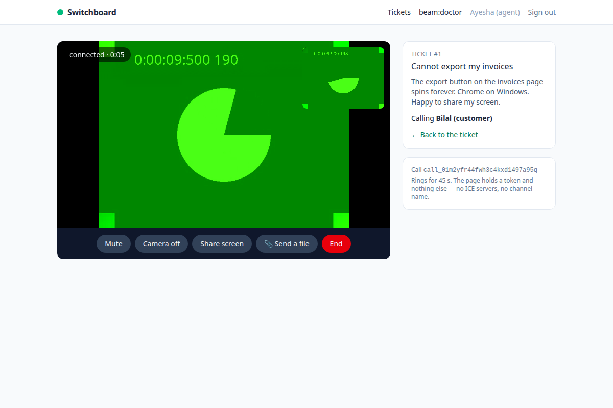

Beam adds real-time audio and video calls, screen sharing, and browser-to-browser file transfer — with a call or without one — to Laravel — the way Laravel Echo added real-time events. PHP decides who may call whom, rings, and mints the credentials a relay needs; the browser joins with one token and two lines.

Most WebRTC in the wild is a thousand lines of JavaScript that works in testing — two tabs on one network — and fails for a fifth of customers, the ones behind a phone carrier or an office firewall. That's where Beam comes in. It handles the parts every hand-rolled implementation gets wrong once — glare, ICE restarts, TURN credentials, autoplay policy, Safari, a tab coming back from the background — and leaves you the parts that are yours: the screen, the authorisation, the history.

[](https://packagist.org/packages/realrashid/beam)
[](https://github.com/realrashid/beam/actions?query=workflow%3Arun-tests+branch%3Amain)
[](https://github.com/realrashid/beam/actions?query=workflow%3A"Browser+Tests"+branch%3Amain)
[](https://www.npmjs.com/package/@realrashid/beam)
[](https://packagist.org/packages/realrashid/beam)

## Quick Look

```php
use RealRashid\Beam\Facades\Beam;

$call = Beam::call($ticket->customer)->video()->about("Ticket #{$ticket->id}")->ring();

return view('beam.call', ['token' => $call->token]);
```

```js
const call = await Beam.join(token);
call.attach({ local: '#me', remote: '#them' });
```

No SDP. No ICE candidates. No `RTCPeerConnection`. No configuration in JavaScript — the token carries the call, the role, the channel and the relay credentials minted for this one participant.

The callee's open tab rings through Laravel Broadcasting; a closed one rings through Web Push. When it's over, `CallEnded` fires on your server with the duration it measured.

## Features

- **Calls and rooms** — `Beam::call($user)` rings a person; `Beam::room($name)` is an address people join.
- **Screen sharing, mute, camera switching, speaker selection** — each a method, each an event.
- **File transfer, peer to peer — with or without a call** — `Beam.send(file).to($userId)`: browser to browser, resumes after a drop, SHA-256 checked, never touches your server. No call in progress? Beam opens a data-only connection for it.
- **Four TURN drivers** — coturn, Cloudflare, Twilio, Metered. Per-participant credentials, minted on the server. [TURN costs money](https://realrashid.github.io/beam/guide/turn); the docs say so on the first page.
- **Rings a closed tab** — Web Push built in; or route `IncomingCallNotification` to FCM and APNs through your own channels.
- **Five frontends, one class** — Blade with no build step (`@beamAssets`), jQuery (`$.beam`), Livewire, Inertia + Vue and React (`useBeam`).
- **Headless** — no UI ships; `beam:install --views` copies a working call screen and incoming-call modal that are yours.
- **`beam:doctor`** — twelve checks, each line saying what to fix.
- **Laravel Boost ready** — ships a guideline and a skill, so an AI assistant in your codebase writes Beam's way: a token to the browser, a gate before a ring, events for history.
- **Tested for real** — `Beam::fake()` for PHP, and a two-browser Playwright rig with fake cameras, a real Reverb server and a real coturn relay for Chromium, WebKit and Firefox.

## Demo Application

**[Switchboard](https://github.com/realrashid/switchboard)** is a ready-to-run support desk that demonstrates everything this package does — an agent calls a customer, the customer's open tab or closed phone rings, a PDF crosses during the call, and the ticket keeps the history. It lives in its own repository:

```bash
git clone https://github.com/realrashid/switchboard.git
cd switchboard
composer install
cp .env.example .env
php artisan key:generate
docker compose up -d     # Reverb and coturn
php artisan migrate --seed
php artisan serve
```

Sign in as `agent@switchboard.test` in one browser and `customer@switchboard.test` in another (password `password`), open the ticket, press **Call customer**.



## Documentation

Ready to explore all the features and options Beam offers? Dive into the documentation:

- [Installation Guide](https://realrashid.github.io/beam/guide/installation)
- [Usage Instructions](https://realrashid.github.io/beam/usage/usage)
- [TURN Costs Money](https://realrashid.github.io/beam/guide/turn)
- [Frontend Integration](https://realrashid.github.io/beam/frontend/overview)
- [Demo Application](https://realrashid.github.io/beam/demo/demo)

## Testing

```bash
composer test
npm test
npx playwright test --project=chromium
```

## Changelog

Please see [CHANGELOG](CHANGELOG.md) for more information on what has changed recently.

## Contributing

Please see [CONTRIBUTING](CONTRIBUTING.md) for details.

## Security Vulnerabilities

If you discover a security vulnerability in Beam, please help us maintain the security of this project by responsibly disclosing it to us. To report a security vulnerability, please send an email to [realrashid05@gmail.com](mailto:realrashid05@gmail.com). We'll address the issue as promptly as possible. See [SECURITY.md](SECURITY.md) for what is in scope.

## Credits

- [Rashid Ali](https://github.com/realrashid)
- [Laravel Echo](https://github.com/laravel/echo), for the pattern
- [coturn](https://github.com/coturn/coturn), for the relay the tests run against
- [All Contributors](../../contributors)

## Support My Work

If you find Beam helpful and would like to support my work, you can buy me a coffee. Your support will help keep this project alive and thriving. It's a small token of appreciation that goes a long way.

[](https://www.buymeacoffee.com/realrashid)

## License

The MIT License (MIT). Please see [License File](LICENSE.md) for more information.

<br />
<p align="center"> <b>Made with ❤️ from Pakistan</b> </p>
