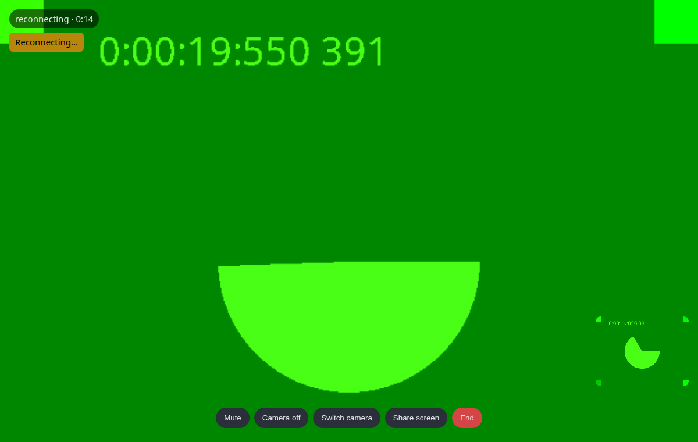

#  Headless by Design

Beam ships no call screen, no incoming-call modal, and no CSS. It ships the class that makes a call work and the events that tell you what is happening; the pixels are yours.

## Why

Every application already has a design system, a component library, and an opinion about where the mute button goes. A call screen that ships with a package is either ignored or fought. What every application lacks is the twelve things a hand-rolled WebRTC implementation gets wrong — glare, queued candidates, ICE restarts, autoplay policy, Safari's codecs, a tab coming back from the background — and that is what Beam ships.

## What you get instead

- A `Call` object with state (`ringing`, `connecting`, `connected`, `reconnecting`, `ended`), events for every change, and controls (`mute()`, `cameraOff()`, `switchCamera()`, `shareScreen()`, `setSpeaker()`, `hangUp()`).
- `attach({ local, remote })`, which takes a selector, an element or a jQuery object and puts the streams in your `<video>` tags.
- An `Incoming` object from `Beam.onIncoming()` with the caller, the `about` line, and `answer()` / `decline()`; render whatever you like around it.
- Adapters that express all of that in Vue's and React's idioms, and a jQuery plugin.

## A starting point when you want one

```bash
php artisan beam:install --views
```

copies a working call screen and an incoming-call modal into `resources/views/beam/` — and, when `package.json` says your app has Vue or React, a `Call.vue` or `Call.jsx` page too. They are plain, documented, and yours: Beam never renders them and never overwrites them without `--force`.



The copied call screen is what the [browser rig](/guide/browser-support) tests, so it connects, counts seconds, mutes and hangs up on the day you copy it.

`beam:install --views` is the friendly front for a publish tag; `php artisan vendor:publish --tag=beam-views` copies the same Blade views on their own, which is what you want in a deployment script or when you only ever wanted the markup.

<br />
<p align="center"> <b>Made with ❤️ from Pakistan</b> </p>
