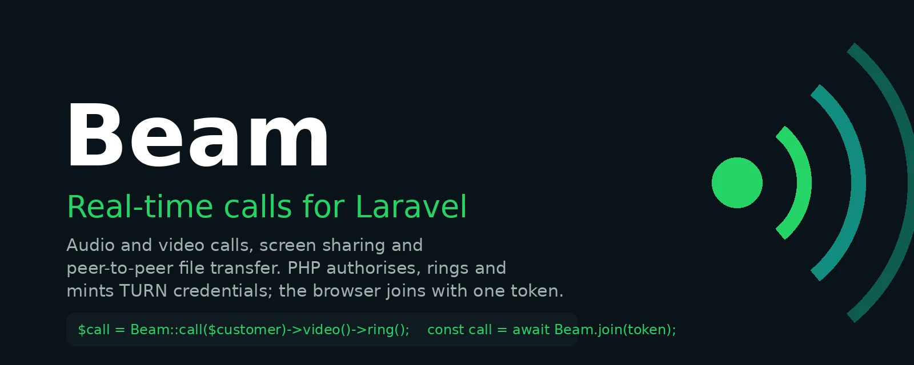
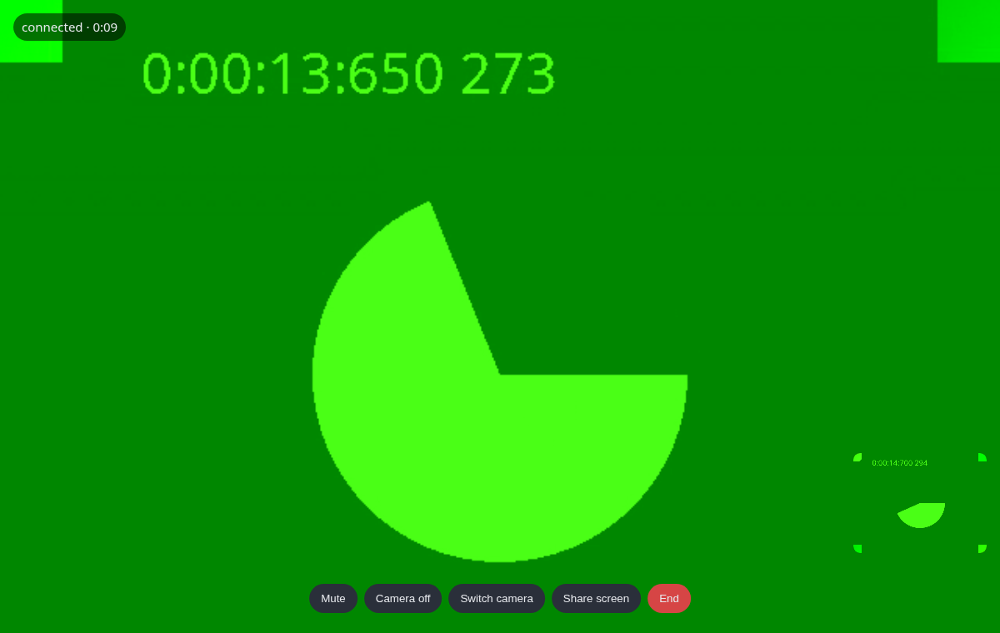
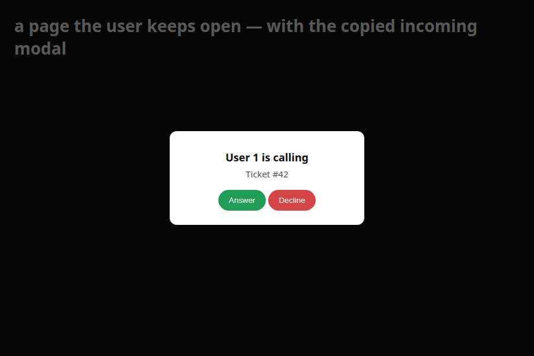
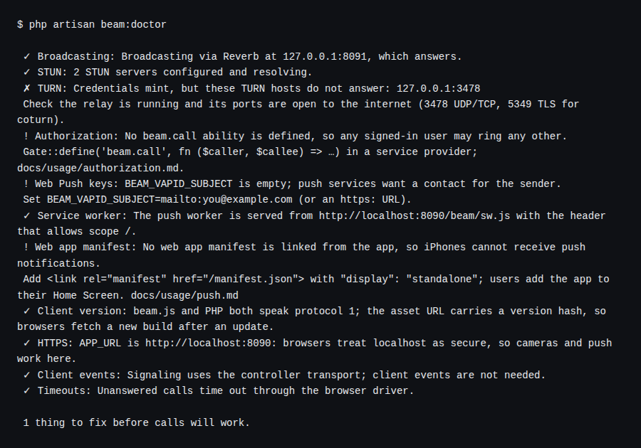

Welcome to the Beam documentation. Beam adds real-time audio and video calls, screen sharing and browser-to-browser file transfer to Laravel applications — the way Laravel Echo added real-time events: PHP authorises, the browser joins with one line, and the hard parts are handled once, for everyone.

## Introduction

A call is two browsers sending media straight to each other. What Laravel has to do is small and precise: decide who may call whom, tell the callee, carry a few messages while the browsers find each other, and mint the credentials a relay needs. Beam does exactly that, and nothing else. It stores nothing, renders nothing, and never sees a frame of video.

Two things this page says before anything else. First, **[TURN costs money](/guide/turn)**: roughly one call in five cannot connect without a relay, and a relay bills by the gigabyte — Beam supports four providers and says so on the first page rather than the last. Second, Beam is **[headless by design](/guide/headless)**: it ships the class that makes a call work and the events that tell you what is happening; the screen is yours, with a working one copied in by `beam:install --views` when you want a start.

## Two things it does

**A call.** One person rings another, or people join a room.

```php
$call = Beam::call($ticket->customer)->video()->about("Ticket #{$ticket->id}")->ring();

return view('calls.show', ['token' => $call->token]);
```

```js
const call = await Beam.join(token);
call.attach({ local: '#me', remote: '#them' });
```

The customer's open tab rings through Laravel Broadcasting; a closed one rings through Web Push. When they answer, the two browsers connect directly — or through the relay you configured — and `CallEnded` fires on your server with the duration when it is over.

**A file.** One person sends another a file, straight from browser to browser. It needs no call: with none in progress, Beam sets up a data-only connection, and the other side sees an offer to accept or decline.

```js
const transfer = Beam.send(file).to(userId);
transfer.on('progress', ({ percent }) => bar.style.width = percent + '%');
await transfer.start();
```

```js
Beam.onFileOffered(async (offer) => {
    const blob = await offer.accept();       // resolves once every byte is in and the hashes agree
    saveAs(blob, offer.name);
});
```

The bytes never touch your server or your storage; `FileTransferred` tells you it happened. [File Transfer](/usage/files) has the whole of it.

## Where it fits

| Situation | What you build with |
|---|---|
| A support agent calls a customer from a ticket, shares a screen, sends a fix | [Support Desk](/example/support-desk) — calls, screen share, a file inside the call |
| A doctor and a patient meet at an appointment link | [Telehealth](/example/telehealth) — rooms with an expiry |
| A signed contract, a scan, a build — sent to one person, stored nowhere | [Secure Documents](/example/secure-documents) — files with no call at all |
| A buyer reaches a seller without either sharing a phone number | [Marketplace](/example/marketplace) — calls gated by a listing |
| A technician shows head office a boiler through a phone camera | [Field Inspection](/example/field-inspection) — the rear camera, a relay on cellular |

## What it looks like

The copied call screen, connected, in the browser rig — two fake cameras, a real Reverb server, real WebRTC:



The incoming-call modal on a page the callee keeps open, and `beam:doctor` on a fresh install:





Every image in these docs is captured by the test rig from the real thing, never mocked up.

## Features

- **Calls and rooms**: `Beam::call($user)` rings a specific person; `Beam::room($name)` creates a stable address people join — a consultation link, a support session.
- **One token, one line**: PHP hands the browser a signed token carrying the call, the role, the channel and the ICE servers. The page contains no configuration.
- **Screen sharing and controls**: mute, camera, switch camera, share screen, choose the speaker — each a method on the call, each an event when it changes.
- **File transfer, peer to peer — with or without a call**: `Beam.send(file).to(userId)` moves a file browser to browser over a data channel, with progress, resume after a drop, and a SHA-256 check at the end. No call in progress? Beam opens a data-only connection for it. Nothing touches your server or storage.
- **Four TURN drivers**: coturn, Cloudflare, Twilio and Metered — per-participant, time-limited credentials minted on the server, never a secret in JavaScript.
- **Rings a closed tab**: Web Push built in, with a service worker Beam serves; or route the notification to FCM and APNs through your own channels.
- **Resilient by default**: perfect negotiation, ICE restarts on a network drop, a heartbeat that lets the server end a call whose browsers both died, duration measured on the server.
- **Five frontends, one class**: Blade with no build step (`@beamAssets`), jQuery (`$.beam`), Livewire, Inertia + Vue (`useBeam`) and Inertia + React (`useBeam`).
- **Testable**: `Beam::fake()` with `assertRang()`, and a two-browser Playwright rig in the repository that proves real calls in Chromium, WebKit and Firefox.
- **Laravel Boost ready**: a shipped guideline and skill, so an AI assistant writes Beam's way — see [Laravel Boost](/guide/boost).
- **`beam:doctor`**: twelve checks — Broadcasting, the cache, STUN, TURN, gates, VAPID keys, the service worker, the manifest, the client version, HTTPS, client events, the queue — each line saying what to do next.

## Getting Started

- [Installation Guide](/guide/installation)
- [Usage Instructions](/usage/usage)
- [Demo Application](/demo/demo)

## Support My Work

If you find Beam helpful and would like to support my work, you can buy me a coffee. Your support will help keep this project alive and thriving. It's a small token of appreciation that goes a long way.

[](https://www.buymeacoffee.com/realrashid)

## License

**Beam** is open-sourced software licensed under the MIT License (MIT). Please see [License File](https://github.com/realrashid/beam/blob/main/LICENSE.md) for more information.

<br />
<p align="center"> <b>Made with ❤️ from Pakistan</b> </p>
