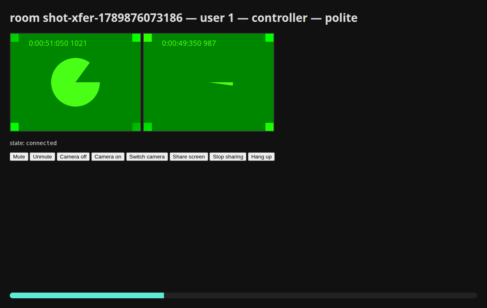

#  File Transfer

A file goes from one browser to the other over a WebRTC data channel. It never touches your server, your storage, or your bandwidth bill — and it arrives with a SHA-256 check that both sides agree on.

It is a feature in its own right, not a side-effect of a call. Two people who are both signed in can send each other files without ever placing one: Beam sets up a data-only connection for the transfer — no camera, no microphone, no ring — and closes it after. Inside a call, the call's own connection carries the file instead. The code is the same either way.

## Sending

```js
const transfer = Beam.send(file).to(userId);        // a File from an <input>, or any Blob

transfer.on('accepted', () => …);
transfer.on('progress', ({ sent, total, percent, bytesPerSecond }) => bar.style.width = percent + '%');
transfer.on('done', () => …);
transfer.on('declined', () => …);

await transfer.start();     // resolves when the receiver reports done; rejects on decline, cancel or failure
```

Inside a call with that user, the call's own connection carries the file. Outside one, Beam asks your server for a data-only connection first (`POST /beam/transfers`, guarded by the [`beam.call` gate](/usage/authorization)) and joins it with no camera and no microphone; the other side's page — any page with `Beam.onIncoming()` on it, which a layout gives every page — connects quietly and sees an offer, not a ring. The recipient needs a tab open; a file cannot be pushed at a closed one, by design.

`transfer.cancel()` stops it; `transfer.state` is `offered`, `accepted`, `transferring`, `done`, `declined`, `cancelled` or `failed`; `transfer.bytesSent` is the count so far.

## Receiving

Nothing arrives unless the receiver accepts:

```js
Beam.onFileOffered(async (offer) => {
    // offer.id, offer.name, offer.size, offer.mime, offer.from {id, name}
    if (!confirm(`${offer.from.name} is sending ${offer.name} (${offer.size} bytes). Accept?`)) return offer.decline();

    offer.on('progress', ({ received, total, percent }) => …);
    const blob = await offer.accept();          // resolves with the whole file once every byte is in and the hash matches
    saveAs(blob, offer.name);
});
```

In Vue and React, `useFileOffers(handler)` does the same for the life of a component; in jQuery, `$.beam.onFileOffered(handler)`.



## What happens underneath

- The offer, accept, decline and done messages travel over signaling, so your server sees them: `FileOffered`, `FileAccepted`, `FileDeclined` and `FileTransferred` fire with the transfer id, both participants, and the file — `$e->file->name`, `$e->file->size`, `$e->file->mime`, plus `$e->file->forHumans()` for a size a page can show. Record what you like; Beam records nothing.
- The bytes travel in 16 KiB chunks over an ordered, reliable data channel, with back-pressure so a fast sender never floods a slow link.
- **A dropped connection pauses, it does not fail.** When the call reconnects, the sender asks where the receiver got to and continues from there; a chunk lost in flight is asked for again by name before the receiver accepts the file. Resumption is tested by killing a TURN relay mid-transfer.
- The end is a SHA-256 from each side. They agree or the transfer fails with `connection-failed` — never a silently corrupt file.
- **`offer.name` and `offer.mime` come from the other browser**, like the body of any request. Escape them before they reach the DOM (the sample above uses `confirm`, which is text), sanitise the name before saving it, and treat `FileOffered`'s metadata as user input if you store it — it is the one part of a transfer your application did not choose.

## Limits and speed

`transfer.max_bytes` in `config/beam.php` (256 MB by default) is the largest file a browser may offer: the sender checks it before offering, the receiver before accepting, and your server refuses an oversize offer with `413 TOO_LARGE`. A receiver also stops a transfer that sends more than it offered, rather than discovering it at the hash.

**That number is about memory, not disk.** The bytes never reach your server, but they do gather in the receiving tab: chunks are held until the last one arrives, and then each side hashes the whole file, because the browser's SHA-256 has no streaming form. Budget about twice the file in the receiving browser — 256 MB of file wants roughly half a gigabyte of headroom — and set the limit against the devices your users actually have, phones included. Raising it to a gigabyte works on a desktop with room to spare and will end a tab on a phone.

Speed depends on the path. Two browsers on one network move tens of megabytes a second; through a relay, or while video is on, the browser's bandwidth estimator paces the data channel with the media, and a transfer ramps up over the first minute. For large files during a video call, expect hundreds of kilobytes a second rather than megabytes; a data-only connection (a transfer outside a call) is not paced with media.

<br />
<p align="center"> <b>Made with ❤️ from Pakistan</b> </p>
